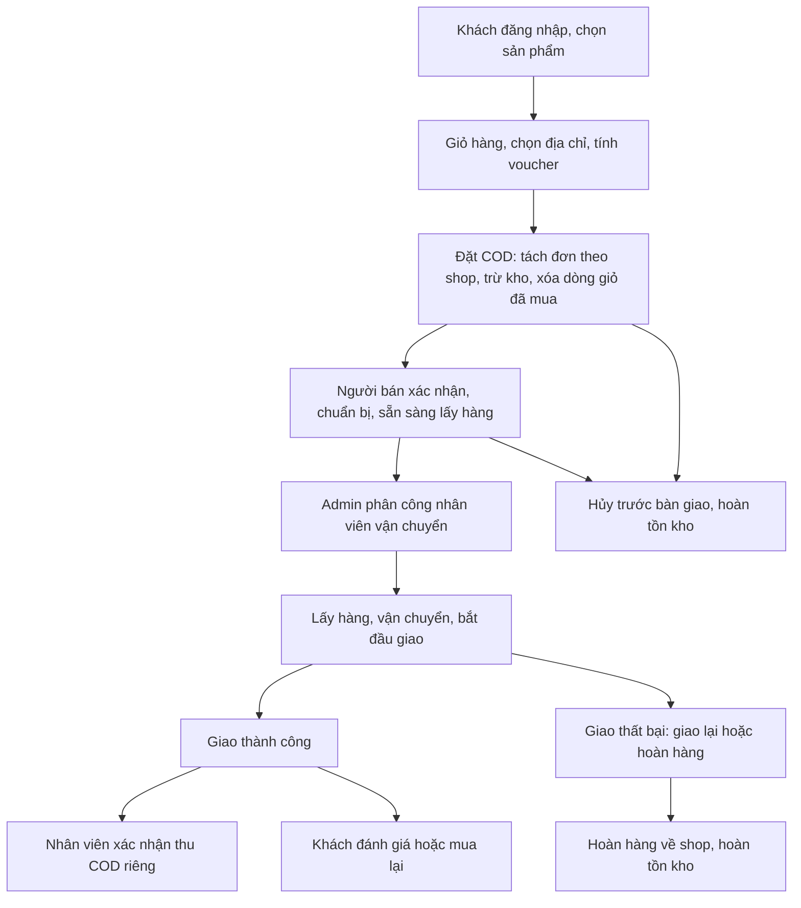

# Kiểm tra luồng nghiệp vụ ngày 16/11/2026

Phạm vi: mã nguồn hiện tại của backend `e-commerce-api` và đối chiếu frontend `e-shopee`, bao gồm các thay đổi đang có trong workspace. Đã kiểm tra API trên MySQL; chưa chạy thao tác trình duyệt từ đầu đến cuối. Không sửa logic ứng dụng trong lần kiểm tra này.

## Cập nhật sau khi sửa 4 lỗi

Phần kiểm tra bên dưới ghi lại trạng thái trước khi sửa. Cả 4 lỗi đã được sửa trong workspace theo yêu cầu tiếp theo:

- Tài khoản không `active` bị chặn ở đăng nhập mật khẩu, callback OAuth và middleware API. Admin khóa tài khoản sẽ thu hồi toàn bộ token; checkout kiểm tra lại trạng thái trong transaction có khóa bản ghi khách.
- Sản phẩm/shop ngừng hoạt động bị ẩn khỏi catalog công khai, bị từ chối khi thêm giỏ, báo giá và checkout. Checkout giữ khóa đọc trên shop tới khi hoàn tất để tránh đặt đơn đồng thời với thao tác khóa shop. Tra cứu slug chỉ đối chiếu ID khi đầu vào hoàn toàn là chữ số.
- `InventoryService` phân bổ tồn model ban đầu vào dòng kho đầu tiên và ghi `opening_balance`, không tăng tồn tổng. Nhập/điều chỉnh kho và checkout dùng chung cơ chế này; các kho tiếp theo không lặp tồn đầu kỳ. Điều chỉnh lỗi rollback cả phần phân bổ.
- Admin được tiếp quản vận đơn `DELIVERED` khi COD còn `pending` và nhân viên/đơn vị cũ không còn hoạt động. Bắt buộc lý do, kiểm tra phiên bản, lưu nhân viên trước/người xử lý, giữ nguyên thời điểm và trạng thái giao hàng. Nhân viên mới phải xác nhận tiền thực thu bằng biên nhận. COD đã thu không được tiếp quản theo nhánh này. Frontend dùng cờ `can_assign` từ API và có hướng dẫn riêng cho tiếp quản COD.

Kiểm thử sau sửa: **33 tests, 526 assertions — đạt** trên MySQL, gồm 11 bài hồi quy mới. Kiểm tra cú pháp PHP các file thay đổi đạt. Frontend `pnpm build` và ESLint cho `CShipmentDetails.vue` đều đạt. Build còn cảnh báo về tên component trùng, `eval` từ dependencies và kích thước bundle. Chưa chạy trình duyệt từ đầu đến cuối. Các bài kiểm thử rollback fixture, không chạy migrate hay seed lại toàn bộ database.

Không cần migration cho các sửa đổi này. Dữ liệu tồn kho từng bị lệch trước đây không tự được sửa theo suy đoán; cần đối chiếu lượng hàng thực tế và lịch sử kho trước khi điều chỉnh.

## Kết quả chính

Luồng COD chính đã được triển khai xuyên suốt, nhưng còn 4 lỗi nghiệp vụ đã tái hiện. Ưu tiên sửa kiểm soát tài khoản/shop, tiếp theo là tồn kho và xử lý COD tồn đọng.

| Mức | Vấn đề | Hậu quả |
| --- | --- | --- |
| P1 | Khóa khách hàng chưa ngăn đăng nhập và đặt hàng | Tài khoản `blocked` vẫn lấy token mới và tạo đơn bằng token cũ |
| P1 | Shop ngừng hoạt động vẫn nhận đơn | Checkout trừ kho nhưng người bán bị chặn xử lý đơn |
| P2 | Nhập kho lần đầu làm lệch tồn khả dụng | Tồn tổng 15 nhưng chỉ bán được 5 |
| P2 | Không có đường tiếp quản COD sau giao hàng khi nhân viên bị khóa | Đơn đã giao bị giữ ở thanh toán `pending` |

P1: nên xử lý trước khi vận hành thực tế. P2: cần xử lý để tránh gián đoạn vận hành và sai lệch số liệu.

## Luồng đang có

- Người bán: khách gửi hồ sơ → admin duyệt → tạo shop → được quản lý sản phẩm và đơn hàng. Hồ sơ bị từ chối có thể gửi lại.
- Giỏ hàng: kiểm tra sản phẩm đang bán, số lượng khả dụng và giá theo số lượng; cập nhật số lượng hiện tại của dòng sản phẩm.
- Checkout: kiểm tra địa chỉ thuộc khách, đối chiếu số lượng với giỏ, tính lại giá tại server, tách đơn theo shop. Mỗi đơn có sản phẩm và khoản COD riêng. Phí vận chuyển hiện là 0, hoa hồng cố định 5%.
- Chống đặt trùng: `request_key` và hash nội dung lưu trong `checkout_receipts`; gửi lại cùng yêu cầu trả về đơn đã tạo.
- Kho: trừ ngay khi đặt hàng, không trừ lần nữa lúc người bán xác nhận; hủy/hoàn hàng ghi biến động hoàn kho.
- Trạng thái đơn: `1` chờ xác nhận → `2` chuẩn bị → `3` đang giao → `4` đã giao. `1/2` có thể hủy thành `5`; `3/4` có thể hoàn thành `6` qua vận đơn hợp lệ.
- Khách chỉ được hủy khi đơn còn `1`. Người bán phải đi lần lượt qua `confirmed`, `preparing`, `ready_for_pickup` rồi tạo vận đơn. Nhân viên được phân công mới có quyền xác nhận vận chuyển và thu COD.
- Giao hàng và thanh toán là hai sự kiện độc lập. Đơn `4` có thể còn COD `pending`; chức năng đánh giá/mua lại căn cứ trạng thái đơn đã giao.
- Vận chuyển có kiểm tra phiên bản, mã yêu cầu chống trùng, lịch sử thao tác và cơ chế tiếp quản một số sự cố khi nhân viên/đơn vị bị khóa.

## Các lỗi đã tái hiện

### 1. P1 — Tài khoản bị khóa vẫn đăng nhập và đặt hàng

Nguồn: `app/Services/AuthService.php:74`, `app/Http/Controllers/Api/AccountManagementController.php:20`, `app/Http/Middleware/AllowAccounts.php`.

Admin chỉ cập nhật `account_status`; phần xác thực kiểm tra mật khẩu nhưng không kiểm tra trạng thái tài khoản. Middleware kiểm tra loại tài khoản, không ngăn tài khoản `blocked`/`inactive`.

Tái hiện: tạo token khách → đổi khách sang `blocked` → đăng nhập với mật khẩu đúng vẫn trả `201` và trạng thái `blocked` → dùng token cũ thêm giỏ và đặt COD vẫn trả `201`.

Đề xuất: chặn cấp token cho tài khoản không `active`; kiểm tra trạng thái trên các request cần đăng nhập và thu hồi token khi khóa. Quy định riêng quyền xem lịch sử/nhận hỗ trợ nếu cần.

### 2. P1 — Shop ngừng hoạt động vẫn nhận đơn mới

Nguồn: `app/Services/CartService.php:41`, `app/Services/OrderService.php:113`, `app/Http/Middleware/RequireSellerShop.php:16`.

Giỏ và checkout kiểm tra trạng thái sản phẩm, tồn kho và `shop_id`, nhưng thiếu `shop.is_active`. Trong khi đó middleware phía người bán chặn shop đã ngừng hoạt động.

Tái hiện: đặt `shops.is_active = 0` → thêm sản phẩm còn Published vào giỏ thành công → tạo đơn COD thành công, kho giảm từ 10 xuống 8 → người bán xác nhận đơn nhận `403`.

Đề xuất: kiểm tra shop hoạt động ở danh sách công khai, giỏ, báo giá và lần kiểm tra cuối trong transaction checkout. Chốt thêm chính sách xử lý đơn cũ khi shop bị khóa.

### 3. P2 — Nhập kho lần đầu làm mất khả năng bán phần tồn sẵn có

Nguồn: `app/Http/Controllers/Api/InventoryController.php:60`, `app/Models/Product/ProductModel.php:42`, `app/Services/OrderWorkflowService.php:101`.

Sản phẩm có thể có `product_models.stock` nhưng chưa có dòng `inventory_stocks`. API điều chỉnh kho khởi tạo dòng kho bằng 0, cộng lượng nhập vào kho và cộng cùng lượng vào tồn tổng. Từ khi có dòng kho, `availableQuantity()` giới hạn theo tồn trong kho; phần tồn ban đầu chưa được phân bổ không còn được tính là khả dụng. Nhánh checkout lại có cơ chế khởi tạo kho từ tồn tổng, nên hai cách khởi tạo không nhất quán.

Tái hiện: tồn model 10, chưa có dòng kho → nhập thêm 5 qua `/shop/inventory/adjust` → tồn model 15, tồn kho 5, tồn khả dụng 5 → thêm 6 sản phẩm vào giỏ bị `422`.

Đề xuất: dùng một quy trình phân bổ tồn ban đầu cho cả tạo sản phẩm, nhập kho và checkout; đảm bảo tồn tổng khớp tổng tồn kho. Ghi nhận phân bổ tồn đầu kỳ bằng lịch sử kho.

### 4. P2 — COD bị kẹt nếu khóa nhân viên sau khi giao nhưng trước khi ghi nhận thu tiền

Nguồn: `app/Services/ShipmentService.php:45`, `app/Services/ShipmentService.php:60`, `app/Http/Middleware/RequireDeliveryStaff.php`.

Thu COD yêu cầu nhân viên đang hoạt động, đúng người được phân công và vận đơn `DELIVERED`. Cơ chế tiếp quản khi nhân viên cũ bị khóa chỉ cho một số trạng thái đang vận chuyển, không gồm `DELIVERED`. Admin cũng bị cấm thực hiện thao tác thu COD trực tiếp.

Tái hiện: đi đủ bước đến `DELIVERED`, COD còn `pending` → khóa nhân viên → nhân viên ghi nhận COD nhận `403` → admin phân công nhân viên thay thế nhận `409` → khoản thanh toán vẫn `pending`.

Đề xuất: bổ sung quy trình đối soát/tiếp quản khoản COD tồn đọng, có quyền riêng, bằng chứng và lịch sử người xử lý. Không tự suy ra đã thu tiền từ trạng thái giao thành công.

## Các giới hạn và chính sách cần chốt

- Thanh toán thẻ đang chủ động tắt; chưa có adapter thu tiền/webhook hoàn chỉnh. COD là phương thức thực tế hiện tại.
- Hoàn hàng đã hoàn tồn kho, nhưng chưa có luồng hoàn tiền cho khoản COD đã `paid`. Mã giữ nguyên `paid`, không tự tạo kết quả hoàn tiền. Cần bổ sung yêu cầu hoàn tiền, duyệt và ghi nhận hoàn tiền thực tế nếu đưa tính năng này vào vận hành.
- Voucher chỉ áp dụng cho đơn của shop đầu tiên theo thứ tự sản phẩm, không áp dụng trên tổng toàn giỏ nhiều shop. Cần mô tả rõ phạm vi trên màn hình hoặc cho khách chọn đơn áp dụng.
- Hủy đơn không trả lại lượt dùng voucher: `voucher_usages` và `used_count` vẫn giữ. Đây là hành vi hiện tại; cần chốt chính sách trước khi coi là lỗi.
- Phí vận chuyển 0 và hoa hồng 5% hiện được đặt trực tiếp trong `OrderService`; chưa thấy bước tính giá vận chuyển theo địa chỉ/đơn vị.

## Bằng chứng kiểm tra

- Bộ kiểm thử hiện có: **22 tests, 373 assertions — đạt**, bật `RUN_MYSQL_CHECKOUT_TESTS=1`.
- Bốn kịch bản kiểm tra bổ sung: **4 tests, 27 assertions — xác nhận được cả 4 hành vi lỗi nêu trên**. Các assertion này mô tả hành vi đang lỗi để tái hiện, không phải tiêu chí chấp nhận nghiệp vụ.
- Các kịch bản MySQL tạo fixture trong transaction và rollback sau khi chạy. Không chạy migrate/seed toàn bộ database.
- PHPUnit không đọc được bootstrap trong sandbox Windows; chạy lại ngoài sandbox đã thành công.
- Chưa kiểm thử giao diện bằng trình duyệt, tải đồng thời hoặc cổng thanh toán thật. Bộ kiểm thử hiện có đạt không có nghĩa các nhánh nêu trên đã được bao phủ.
